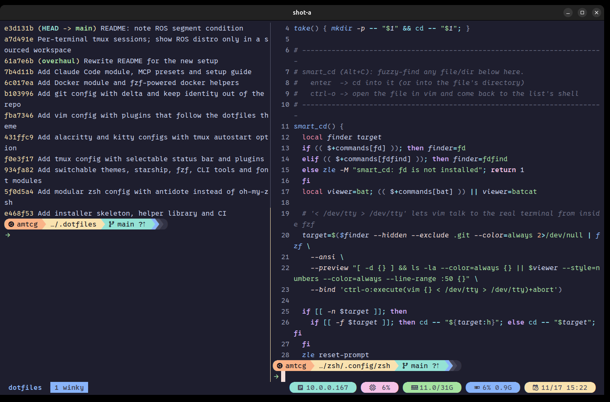
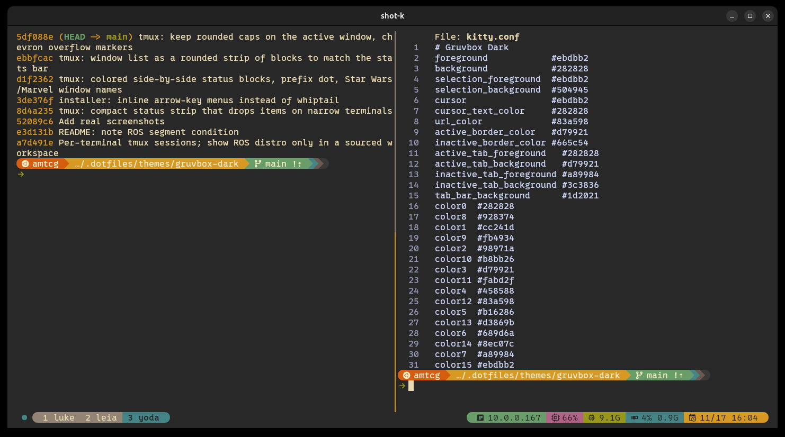
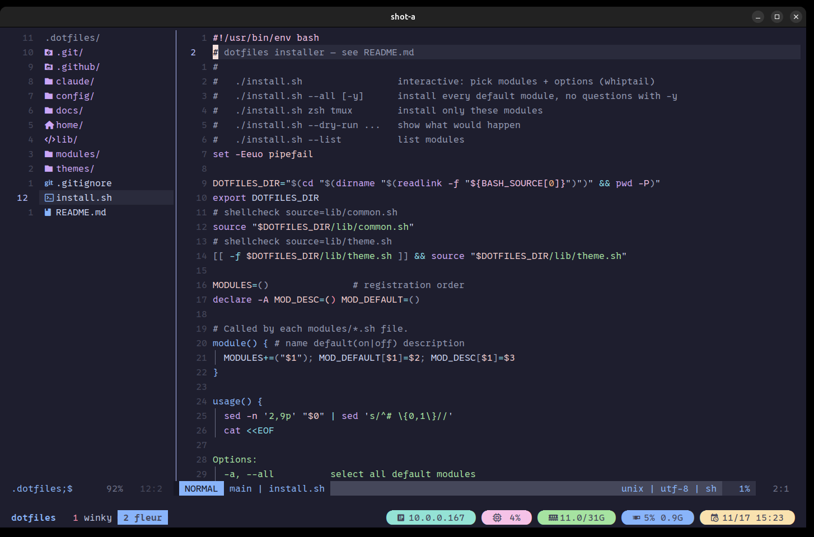
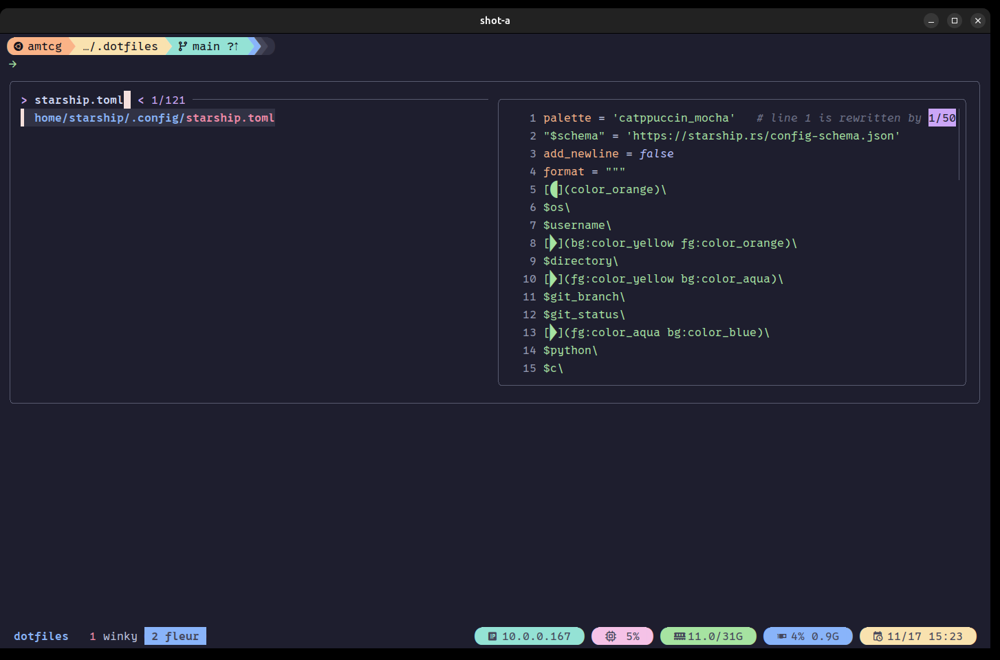

# .dotfiles

My terminal setup for Ubuntu/Debian: **zsh + starship + tmux** in **Alacritty or kitty**,
with matching themes everywhere, a vim that's actually pleasant, Docker helpers and a
Claude Code setup. One script installs all of it, either fully automatic or step by step.



| | |
|---|---|
|  |  |
|  |  |

> Screenshots live in `docs/screenshots/` (see the note there on how they're made).

---

## Quick start

```bash
git clone git@github.com:gonzal0lguin/.dotfiles.git ~/.dotfiles
cd ~/.dotfiles
./install.sh            # step by step: pick modules and options in a menu
```

Fully automatic (asks for your sudo password once, uses the defaults):

```bash
./install.sh --all --yes
```

Other ways to run it:

```bash
./install.sh tmux vim               # only some modules
./install.sh --dry-run --all        # show what would happen, change nothing
./install.sh --no-packages zsh      # no sudo/apt: only links + user-level installs
./install.sh --list                 # list modules
THEME=gruvbox-dark TMUX_STATUS=minimal ./install.sh --all -y   # preset the choices
```

At the end the installer prints a short checklist of the things it can't do for you
(log out/in for the new shell and docker group, `claude` login, `gh auth login`, ...).

Re-running is safe: things that are already installed are skipped, links are refreshed.
Any file the installer would replace is moved to `~/.dotfiles-backup/<date>/` first.

## Modules

| Module | What you get | Default |
|---|---|---|
| `base` | git, curl, stow, jq… and the `dot` command | always |
| `fonts` | **0xProto Nerd Font** (latest nerd-fonts release) | on |
| `themes` | one theme for every app: `catppuccin-mocha` or `gruvbox-dark` | on |
| `zsh` | modular zsh, **antidote** plugins, untracked `local.zsh` + `secrets.zsh` | on |
| `starship` | prompt with git, languages, docker, conda, **ROS distro** (only in a sourced colcon workspace), command time | on |
| `fzf` | latest fzf (Ubuntu's is too old for `fzf --zsh`) | on |
| `cli` | eza, ripgrep, fd, bat, zoxide, btop, delta, jq, tldr, ncdu, gh, lazygit | on |
| `tmux` | config, **stats** or **minimal** status bar, TPM + resurrect/continuum/yank | on |
| `alacritty` | Alacritty from **apt** (no cargo) | on |
| `kitty` | kitty (official build in `~/.local`, or apt) | on |
| `defterm` | make Alacritty or kitty the default terminal (Ctrl+Alt+T) | off |
| `vim` | vim-gtk3 (clipboard) + plugins, themed | on |
| `git` | delta pager, aliases, sane defaults; identity in `~/.gitconfig.local` | on |
| `docker` | Docker Engine (official repo), NVIDIA toolkit, lazydocker, dive, helpers | on |
| `claude` | Claude Code settings, commands, plugins, MCP servers, `ccmcp` | on |

## The `dot` command

```bash
dot update            # git pull + re-link + update zsh/tmux/vim plugins
dot theme             # list themes
dot theme gruvbox-dark  # switch every app (terminal, prompt, fzf, bat, vim, btop)
dot install tmux      # re-run a module (e.g. to change its options)
dot link vim          # (re)link one package
dot doctor            # check that everything is installed
cd "$(dot cd)"        # go to the repo
```

## Layout

```
install.sh          entry point
lib/                shared shell helpers (common.sh, theme.sh, json.jq)
modules/            one file per module (NN-name.sh), run in order
home/<pkg>/         files linked into $HOME with GNU stow (--no-folding)
themes/<name>/      per-app theme files; ~/.config/dotfiles/current points to one
claude/             Claude Code settings (merged) and MCP presets
config/             data files (docker image list)
docs/               Claude guide, screenshots
```

State lives in `~/.config/dotfiles/` (chosen theme and options, generated starship config).

## zsh

`~/.zshrc` only loads the files in `~/.config/zsh/`, in this order:

| File | Contents |
|---|---|
| `env.zsh` | PATH, XDG dirs, editor, theme colors |
| `options.zsh` | history (100k, shared, no duplicates), `auto_cd`, … |
| `secrets.zsh` | **untracked**, `chmod 600`: tokens and API keys |
| `plugins.zsh` / `plugins.txt` | antidote and the plugin list |
| `keybinds.zsh` | emacs keys, ↑/↓ prefix history search, ctrl+arrows |
| `aliases.zsh` | your aliases (`..`, `rmf`, `cl`, `lg`, eza `ls/ll/la/lt`, …) |
| `functions.zsh` | `take`, `ds`, `smart_cd` |
| `fzf.zsh` | fzf keys + options |
| `docker.zsh` | docker helpers |
| `claude.zsh` | `claude` tmux wrapper (for auto-compact) |
| `tools.zsh` | zoxide, direnv, starship |
| `local.zsh` | **untracked**: machine-specific stuff (ROS, project aliases, venvs) |

**Secrets:** never put tokens in tracked files. Put them in `~/.config/zsh/secrets.zsh`
(created from `secrets.zsh.example`), or better, ask a tool for them:
`export GITHUB_TOKEN=$(gh auth token)`. Start a command with a space to keep it out of
the history.

**Plugins** ([antidote](https://antidote.sh), no oh-my-zsh): zsh-completions,
fzf-tab, zsh-autosuggestions, fast-syntax-highlighting, plus oh-my-zsh's `sudo` and
`extract` plugins loaded on their own. Add one: put `user/repo` in
`~/.config/zsh/plugins.txt` and open a new shell. Update: `antidote update`.

### Keys and helpers

| Key / command | Does |
|---|---|
| `Ctrl+R` | fuzzy history |
| `Ctrl+T` | fuzzy file picker, pastes the path |
| `Alt+C` | **smart_cd**: fuzzy find a file/dir and cd there; `Ctrl+O` opens it in vim |
| `Tab` | completion menu with previews (fzf-tab); `<` `>` switch groups |
| `→` | accept the grey suggestion |
| `Esc Esc` | put `sudo` in front of the command |
| `Ctrl+X Ctrl+E` | edit the command in vim |
| `z <dir>` / `zi` | jump to a frequent directory (zoxide) |
| `ds [dir]` | colored disk usage, biggest last |
| `take <dir>` | mkdir + cd |
| `extract <file>` | unpack any archive |

## tmux

Prefix is **`Ctrl+A`**.

| Key | Does |
|---|---|
| `prefix q` / `prefix w` | split side by side / stacked |
| `prefix n` | new window |
| `Alt+←↑→↓` | move between panes (no prefix) |
| `prefix H J K L` | resize pane |
| `prefix s` / `prefix W` | pick session / window |
| `prefix r` | reload config |
| `prefix [` then `v` / `y` | copy mode: select / copy to clipboard |
| `prefix Ctrl+S` / `Ctrl+R` | save / restore sessions (resurrect) |
| `prefix I` / `U` | install / update plugins |

**Status bar** (`dot install tmux` to change): `stats` shows IP, CPU, RAM, NVIDIA GPU
(when present) and date; `minimal` shows host and date. Colors use the terminal palette,
so they follow the theme. Blocks drop out on narrow windows (IP < 100 columns, GPU < 90,
date < 80). The dot on the left turns green while the prefix is held.

**Window names** (optional): new windows get random Harry Potter, Star Wars and/or Marvel
character names (pick any in the installer); each session sticks to one universe.

Personal tweaks: `~/.config/tmux/local.conf` (untracked).

**Autostart:** the installer can make Alacritty/kitty open straight into tmux
(a new `tmux new-session` per window, so each terminal gets its own session). It's done by the terminal, not `.zshrc`, so VS Code terminals
and ssh sessions aren't affected. Off by default.

## Terminals

- **Alacritty** comes from apt. The config is written for 0.13 (Ubuntu 24.04) and still
  works on newer versions. If you also have the snap, the installer offers to remove it
  (it leaks snap paths into your shell).
- **kitty** uses the same font, padding and theme; its tab bar is hidden because tmux
  does tabs.
- Overrides per machine: `~/.config/alacritty/local.toml`, `~/.config/kitty/local.conf`.
- `Shift+Enter` inserts a newline in Claude Code in both terminals and inside tmux.

## Themes

```bash
dot theme catppuccin-mocha
dot theme gruvbox-dark
```

Switches Alacritty and kitty (live), the starship palette, fzf, bat/delta, vim
(lightline too) and btop. Open a new shell for prompt/fzf colors.
Add a theme: copy a folder in `themes/`, change the colors, add a starship palette to
`home/starship/.config/starship.toml`.

## vim

Leader is **Space**. Plugins install themselves on first start (vim-plug).

| Key | Does |
|---|---|
| `<leader>f` / `g` / `b` / `h` | files / ripgrep / buffers / recent files (fzf) |
| `<leader>/` | search lines in this file |
| `<leader>e` | file tree (fern) |
| `<leader>u` | undo tree (undo history survives restarts) |
| `<leader>gs` | git status (fugitive); `]h` `[h` next/prev change |
| `gcc` / `gc` | comment line / selection |
| `cs"'`, `ds(`, `ysiw]` | change / delete / add surroundings |
| `Ctrl+H J K L` | move between splits |
| `<leader><space>` | clear search highlight |

Copy/paste uses the system clipboard. Local tweaks: `~/.vim/local.vim`.

## Docker

| Command | Does |
|---|---|
| `dps`, `dimg` | tidy container / image lists |
| `dsh [name]` | shell inside a container (fzf picker without a name) |
| `dlogs [name] [n]` | follow logs |
| `dstop`, `drm`, `drmi` | stop / remove containers / remove images (multi-select) |
| `dip [name]` | container IPs |
| `dclean` | free space, asking before each level |
| `dgui <image> [cmd]` | run GUI apps (rviz, gazebo) with X11, GPU, host network, `$PWD` at `/work` |
| `dpull <group>` | pull image groups from `config/docker-images.txt` (`ros`, `base`, `ml`, `all`) |
| `dc`, `dcu`, `dcd`, `dcl` | docker compose, up -d, down, logs |
| `lzd` | lazydocker |

The installer adds log rotation to `/etc/docker/daemon.json` (your existing settings,
like the nvidia runtime, are kept) and the NVIDIA container toolkit on GPU machines.
Your own images: `~/.config/dotfiles/docker-images.txt`.

## Claude Code

See **[docs/claude.md](docs/claude.md)**: settings merge, slash commands, skills, agents,
plugins (auto-compact), MCP servers and the `ccmcp` presets
(`ccmcp kicad` in a KiCad repo, `ccmcp ros`, `ccmcp github`).

## Moving from the old setup (oh-my-zsh, ~/.dotfiles links)

1. Clone this repo anywhere and run `./install.sh`. Existing files and old symlinks
   (`~/.zshrc`, `~/.tmux.conf`, `~/.config/alacritty`, `~/.gitconfig`, …) are moved to
   `~/.dotfiles-backup/<date>/`.
2. Move your machine-specific lines (ROS, project aliases) to `~/.config/zsh/local.zsh`
   and tokens to `~/.config/zsh/secrets.zsh`.
3. When everything works: `rm -rf ~/.oh-my-zsh`.

## Troubleshooting

- **Squares instead of icons**: the terminal isn't using *0xProto Nerd Font*
  (`fc-list | grep 0xProto`; re-run `./install.sh fonts`).
- **Old config still active in tmux**: `tmux kill-server` (or `prefix r`).
- **`docker: permission denied`**: log out and back in after the install (docker group).
- **Slow shell start**: measure with `time zsh -ic exit`; comment out plugins in `plugins.txt` to compare.
- **Something else**: `dot doctor`, then re-run the module with `./install.sh <module>`.

## Credits

Started as a fork of [hamvocke/dotfiles](https://github.com/hamvocke/dotfiles).
Themes: [Catppuccin](https://catppuccin.com), [Gruvbox](https://github.com/morhetz/gruvbox).
